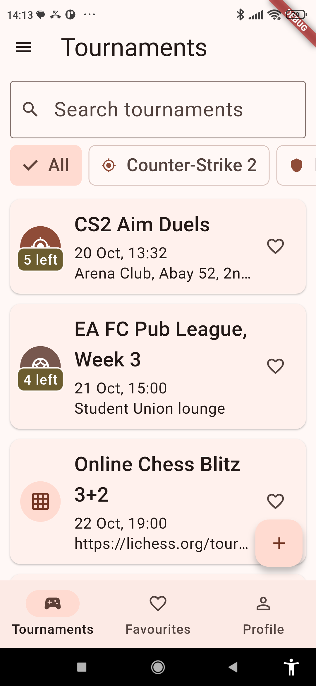
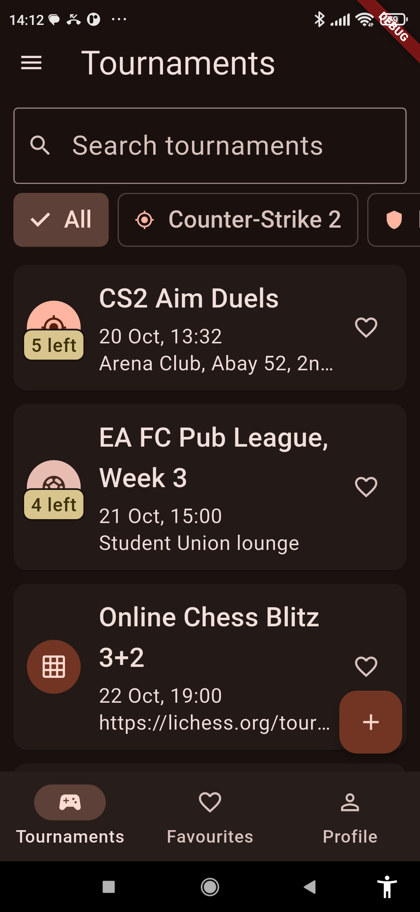
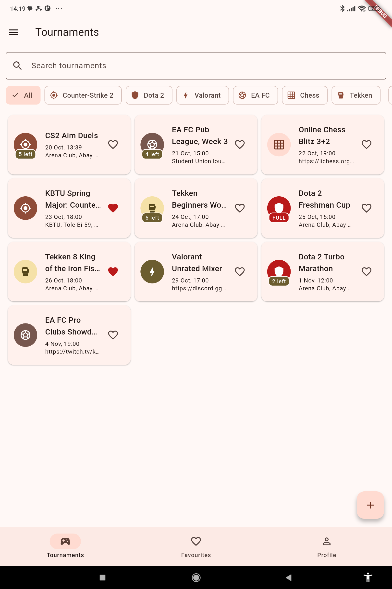

# Arena — Lab 1

**Domain:** tournaments at the KBTU student gaming club. Each tournament has a
discipline (Counter-Strike 2, Dota 2, Valorant, EA FC, Chess, Tekken), a start
time, a venue and a number of slots that the list of players counts against.
An **online** tournament has a stream link instead of a venue. You can join
with the name from your profile, favourite tournaments, and create or edit them.

All data lives in memory: twelve seed tournaments, dates relative to today.

## Screenshots

| Phone, light | Phone, dark | Tablet, grid |
|---|---|---|
|  |  |  |

## Run

Android Studio: File → Open → this folder, pick a device, Run.

```
flutter pub get
flutter run
flutter analyze
```

## Decisions

The tournament list and the profile live in the shell's `State`, because three
tabs and the pushed screens all need them; the tabs only receive them through
their constructors and report changes back up through callbacks.
The detail screen gets callbacks in its route arguments because it changes a
tournament the shell owns (Join, Edit, Delete), while the form returns the
finished `Tournament` through `pop` and the caller decides what to do with it —
the form never touches the list.
The grid is chosen by `LayoutBuilder` rather than `MediaQuery` because what
matters is the width this widget actually gets, not the width of the screen.
`PopScope` compares a record of every field's current value with the record
taken when the form opened, so typing and then undoing the change makes the
form clean again.
With week 9's tools I would move the list and the profile out of the shell
into a shared state object and persist them, so callbacks would stop being
passed through every screen and the data would survive a restart.
